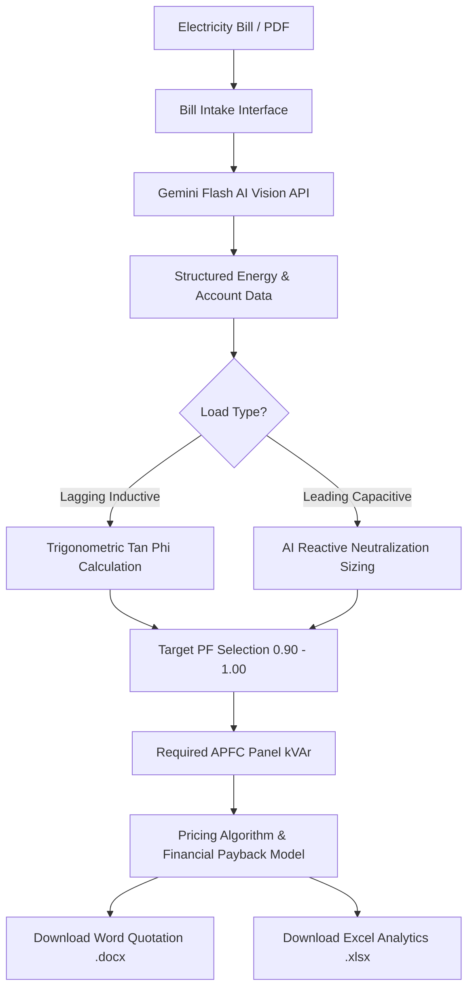

# ElectraPF Pulse: Intelligent Power Factor Analytics & Commercial Proposal Engine

---

## 1. Executive Summary

**ElectraPF Pulse** is a state-of-the-art industrial electrical power analytics platform and commercial proposal engine designed for energy auditors, electrical engineers, and commercial solution providers (specifically tailored for **SEE-Tech Solutions Pvt. Ltd.**).

The platform bridges the gap between raw utility billing documents and actionable electrical engineering interventions:
1. **Automated Utility Bill Ingestion**: Extracts complex billing metrics from uploaded electricity bill images or multi-page PDFs using Gemini AI Vision.
2. **Dual-Path Power Factor Analysis**: Evaluates electrical efficiency by distinguishing between inductive (lagging) load penalties and capacitive (leading) over-compensation.
3. **Engineering-Grade kVAr Sizing**: Uses standard displacement factor ($\tan \phi$) trigonometry and standard capacitor chart mapping to calculate required APFC (Automatic Power Factor Correction) panel capacities.
4. **Financial Payback & ROI Modeling**: Automatically calculates dynamic unit tariff rates, monthly/annual savings, and exact ROI payback periods in months.
5. **One-Click Commercial Deliverables**: Generates professionally styled MS Word (`.docx`) formal quotations and formatted Excel (`.xlsx`) analytical spreadsheets with company branding.

---

## 2. Key Features

### 📄 Intelligent Bill Parsing (OCR & Vision AI)
- Multi-format ingestion: PNG, JPEG, and multi-page PDF documents.
- Direct hardware camera capture support for on-site facility surveys.
- Extracts customer details, sanctioned load/demand, minimum billing demand, tariff categories, and four-quadrant energy parameters ($kWh$, $kVARh_{\text{lag}}$, $kVARh_{\text{lead}}$, $kVAh$).
- Schema-constrained JSON extraction powered by `@google/genai` (Gemini Flash).

### ⚡ Dual-Path Load Characterization
- **Lagging Phase (Inductive)**: High inductive loads (motors, transformers) causing reactive power lag ($kVARh_{\text{lag}} > kVARh_{\text{lead}}$). Calculated via standard trigonometric matrix formulas.
- **Leading Phase (Capacitive)**: Over-compensated networks ($kVARh_{\text{lead}} > kVARh_{\text{lag}}$). Analyzed using AI reactive imbalance inference to determine anti-resonance/neutralization panel sizing.
- **Meter Calibration Drift Detection**: Compares utility meter reported PF against true calculated PF ($kWh / kVAh$), raising immediate calibration alerts if variance exceeds threshold ($> 0.05$).

### 🧮 Interactive APFC Capacitor Planner
- Interactive target PF selector ($0.90$ to $1.00$).
- Standard reference step truncation matching commercial engineering lookup charts.
- Real-time dynamic calculation of required $kVAr$ rating based on active sanctioned load ($kW$).

### 💼 Commercial Advisor & Pricing Engine
- Standard inventory tier matching: $30\text{ kVAr}$, $60\text{ kVAr}$, $80\text{ kVAr}$, $85\text{ kVAr}$, $150\text{ kVAr}$.
- Non-linear regressive interpolation pricing algorithm for custom panel capacities.
- Full manual override capability for unit list prices and panel sizes.

### 📊 Real-Time Financial ROI Analysis
- Dynamic tariff calculation excluding fixed demand charges: 
  $$\text{Effective Tariff Rate (₹/unit)} = \frac{\text{Total Bill Amount} - \text{Fixed Demand Charges}}{\text{Total Active Consumption (kWh)}}$$
- Projected kVAh energy reduction per billing cycle.
- Annual cost savings and investment payback period in months.

### 📥 Enterprise Document & Spreadsheet Exports
- **Word Quotation (`.docx`)**: Complete with company header (SEE-Tech Solutions Pvt. Ltd.), quotation numbers, itemized supply/installation pricing, technical specifications (Entes RGP12 relay), scope of work, savings analysis, and terms & conditions.
- **Excel Analytics (`.xlsx`)**: Formatted multi-column workbook with embedded company logo, custom borders, number formatting (`#,##,##0`), and calculation tables.

---

## 3. Technology Stack

| Layer | Technology | Purpose |
| :--- | :--- | :--- |
| **Framework** | [React 19](https://react.dev/) + [TypeScript](https://www.typescriptlang.org/) | Core reactive user interface and strict type safety |
| **Build Tool** | [Vite 6](https://vite.dev/) | Lightning-fast HMR and bundling |
| **Styling** | [Tailwind CSS v4](https://tailwindcss.com/) + Custom Glassmorphism | Custom design tokens, glassmorphism UI, responsive layouts |
| **Animations** | [Motion (framer-motion v12)](https://motion.dev/) | Fluid micro-interactions, layout transitions, and card entries |
| **Charts & Data Viz**| [Recharts v3](https://recharts.org/) | Multi-color energy breakdown bar charts and interactive tooltips |
| **AI Intelligence**| [@google/genai SDK](https://www.npmjs.com/package/@google/genai) | Gemini Flash model for multimodal vision document extraction |
| **Document Export**| [docx](https://docx.js.org/) | Programmatic creation of structured `.docx` quotation files |
| **Spreadsheet Export**| [exceljs](https://github.com/exceljs/exceljs) + [file-saver](https://www.npmjs.com/package/file-saver) | Client-side styled workbook builder with image embedding |
| **Icons** | [Lucide React](https://lucide.dev/) | Consistent iconography across dashboards and controls |

---

## 4. Mathematical & Engineering Foundations

### 4.1. Power Factor Calculation
$$\text{Calculated Power Factor (PF)} = \frac{kWh}{kVAh}$$

### 4.2. Reactive Power Compensation ($kVAr$)
The required capacitive reactive power to raise the power factor from $\text{PF}_1$ (present) to $\text{PF}_2$ (target) under a given active load $P$ (in $kW$) is:

$$\phi_1 = \arccos(\text{PF}_1)$$
$$\phi_2 = \arccos(\text{PF}_2)$$
$$\text{Factor } F = \tan(\phi_1) - \tan(\phi_2)$$
$$\text{Required } kVAr = P_{\text{load}} (kW) \times \text{Factor } F$$

> **Note on Engineering Precision**: `pfMath.ts` applies a 4-decimal truncation to Factor $F$ and truncates the baseline PF to two decimal places (e.g., $0.805 \rightarrow 0.80$) to match standard electrical engineering industry look-up tables.

### 4.3. Financial ROI & Payback Model

1. **Calculated Tariff Rate**:
   $$\text{Tariff Rate (₹/kVAh)} = \frac{\text{Bill Amount} - \text{Demand Charges}}{kWh}$$
2. **Monthly Energy Savings**:
   $$\text{Saving (kVAh/month)} = \max(0, (kVAh - kWh) \times \text{Target PF})$$
3. **Monthly Financial Savings**:
   $$\text{Saving (₹/month)} = kVAh \times \text{Tariff Rate}$$
4. **Annual Financial Savings**:
   $$\text{Saving (₹/year)} = 12 \times \text{Saving (₹/month)}$$
5. **Total Capital Expenditure (CapEx)**:
   $$\text{Total Investment} = \text{Panel Price} + ₹20,000 \text{ (Installation \& Commissioning)}$$
6. **Payback Period**:
   $$\text{Payback (Months)} = \frac{\text{Total Investment}}{\text{Annual Savings}} \times 12$$

---

## 5. Codebase Structure & Architecture

```
ELECTRAPF-PULSE/
├── .env                  # Environment variables (GEMINI_API_KEY)
├── .env.example          # Environment template
├── index.html            # HTML entry point
├── package.json          # Dependencies & execution scripts
├── tsconfig.json         # TypeScript compiler configuration
├── vite.config.ts        # Vite build & alias configurations
├── PROJECT_DOCUMENTATION.md # This comprehensive documentation
├── src/
│   ├── App.tsx           # Main application shell, state management & logic guide
│   ├── main.tsx          # React DOM root mounting
│   ├── index.css         # Design system tokens, utilities & custom animations
│   ├── components/
│   │   ├── BillUploader.tsx   # Drag-and-drop file uploader & camera scanner
│   │   └── PFDashboard.tsx    # 7-panel power analytics, charts & export engine
│   ├── lib/
│   │   ├── pfMath.ts          # Trigonometric compensation & PF lookup formulas
│   │   └── utils.ts           # Class merge (clsx + twMerge) helper
│   └── services/
│       └── gemini.ts          # Google GenAI integration & extraction schema
```

---

## 6. Detailed Component Breakdown

### `src/App.tsx`
- Acts as the central orchestrator holding state for `billData`, `isLoading`, `error`, and `showTheory`.
- Houses the top glassmorphism navigation header with real-time status pulses.
- Renders the collapsible **"Technical Concept Guide"** explaining lagging vs leading power factor fundamentals.
- Conditionally renders `PFDashboard` upon successful Gemini AI parsing.

### `src/components/BillUploader.tsx`
- Provides drag-and-drop and manual file selection for `.png`, `.jpg`, `.jpeg`, and `.pdf`.
- Supports direct device camera activation (`capture="environment"`).
- Handles local file preview and conversion to base64 for transmission to the Gemini API.
- Displays animated radar/spinners during AI vector extraction with collapsible system diagnostics logs.

### `src/components/PFDashboard.tsx`
Divided into 7 distinct functional sections:
- **Panel 02: Account & Demand Profile**: Displays customer metadata, address, contact, sanctioned load ($kW$), contract demand ($kVA$), minimum demand, and actual demand.
- **Panel 03: Energy Consumption Log**: Metric cards for $kWh$, $kVAh$, $kVARh_{\text{lag}}$, $kVARh_{\text{lead}}$, along with a Recharts comparative bar chart and meter drift monitoring.
- **Panel 04: Load Characterization**: Visual pulse badge of the Power Factor, operating quadrant status (Lagging / Leading / Unity), and markdown-rendered AI Field Insights.
- **Panel 05: Optimization & Capacitor Planner**: Interactive target PF selection matrix ($0.90 - 1.00$), step-by-step mathematical breakdown, and recommended panel capacity in $kVAr$.
- **Panel 06: Commercial Proposal & Investment Analysis**: Price estimation, catalog switcher, unit list price override, and one-click Word/Excel download buttons.
- **Panel 07: Projected Financial Saving Analysis**: Summarizes monthly/annual cost reductions, kVAh recovery rate, and total payback duration in months.

### `src/services/gemini.ts`
- Interfaces with `@google/genai` using the `gemini-flash-latest` model.
- Enforces strict structured JSON output via `responseSchema` (Type.OBJECT).
- Directs the AI to perform OCR extraction across account, energy, and demand fields, while conducting a dual-path check for inductive vs capacitive states.

### `src/lib/pfMath.ts`
- Contains `calculateKVArCorrection(currentPF, targetPF, loadKW)`.
- Contains `getNearestStandardPF(pf)` with standard range clamping between $0.50$ and $0.99$.

---

## 7. Catalog & Pricing Engine

The system contains a baseline catalog of industrial APFC panels:

| Rating ($kVAr$) | Baseline Price (₹) | Approximate Cost/kVAr |
| :---: | :---: | :---: |
| **30** | ₹51,800 | ₹1,727 |
| **60** | ₹74,000 | ₹1,233 |
| **80** | ₹89,400 | ₹1,118 |
| **85** | ₹91,700 | ₹1,079 |
| **150** | ₹1,68,700 | ₹1,125 |

For ratings between defined catalog tiers, the platform executes linear piece-wise interpolation:
$$\text{Price} = P_1 + \frac{kVAr - R_1}{R_2 - R_1} \times (P_2 - P_1)$$
For ratings exceeding $150\text{ kVAr}$, unit pricing scales proportionally based on the top tier unit rate.

---

## 8. Installation & Local Development

### Prerequisites
- [Node.js](https://nodejs.org/) (version 18.0 or higher recommended)
- A valid Google Gemini API Key

### Setup Instructions

1. **Clone or Navigate to the Workspace Directory**:
   ```bash
   cd ELECTRAPF-PULSE
   ```

2. **Install Dependencies**:
   ```bash
   npm install
   ```

3. **Configure Environment Variables**:
   Create or edit `.env` in the root directory:
   ```env
   GEMINI_API_KEY=your_gemini_api_key_here
   ```

4. **Start the Development Server**:
   ```bash
   npm run dev
   ```
   The local Vite server will launch at `http://localhost:3000/`.

5. **Build for Production**:
   ```bash
   npm run build
   ```

6. **Preview Production Build**:
   ```bash
   npm run preview
   ```

---

## 9. Typical Workflow Example



1. **Upload**: User drops a commercial/industrial electricity bill (JPEG/PNG/PDF).
2. **Extraction**: Gemini extracts account numbers, bill amount, kWh, kVAh, kVARh (Lag & Lead), sanctioned load, and demand metrics.
3. **Assessment**: The dashboard displays the calculated power factor, load quadrant, and identifies any tariff or meter anomalies.
4. **Planning**: The engineer adjusts the target PF (e.g. from $0.82 \rightarrow 0.99$).
5. **Proposal**: System computes required $kVAr$ capacity, looks up panel pricing, adds ₹20,000 installation charges, and projects annual financial savings and payback in months.
6. **Export**: With a single click, a finalized corporate quotation (`.docx`) or analytical spreadsheet (`.xlsx`) is generated and downloaded ready for client submission.

---
*Documentation compiled for ElectraPF Pulse • SEE-Tech Solutions Pvt. Ltd.*
